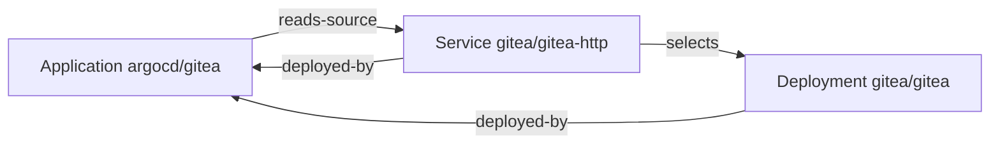

# Concepts

The words crankpath uses in its report, what each means, and what it never means. The report's exact shapes are in [JSON output](json-output.md); the input file is described in [the crankpath.yaml reference](crankpath-yaml.md).

## Black start

After a total blackout, a grid operator follows a black-start plan: the plants that can start with no grid power come up first, and the rest come back in an order that each step makes possible. A GitOps estate has the same problem after a total loss: Argo CD or Flux must be running to deploy anything, and what it needs to run (its Git server, its credentials, its secrets backend) may be something it deploys itself. crankpath reads the estate's repository, with no cluster, and asks: from nothing, what can start, in what order, and what must a person do by hand first.

## Nodes and edges

A **node** is one Kubernetes object the estate defines, named by its canonical id: `Kind/namespace/name`, or `Kind/name` for a cluster-scoped kind (`Namespace/gitea`, `ClusterIssuer/ca`). A node outside the estate is an **external**, `external:<name>` (`external:github.com`). Ids are built only from Kubernetes name syntax, so a name in the repository cannot forge another node's id; an object whose name is not valid is skipped and named.

An **edge** points from a node to what it needs to start: `Application/argocd/gitea` reads its source from `Service/gitea/gitea-http`; `Service/gitea/gitea-http` is deployed by `Application/argocd/gitea`. Each edge has a kind (`deployed-by`, `reads-source`, `needs-secret`, `needs-config`, `selects`, `issued-by`, `seals-with` and the others listed in [JSON output](json-output.md)) and a source:

- `extracted`: read from a field of an object crankpath read or rendered, with the file, field and rendered path as evidence;
- `declared`: written in `crankpath.yaml` (an `edges:` entry, a `match:` entry that places a host, a crank's reroute). crankpath has not seen it in the estate: the report counts declared edges as unverified, and a cycle that rests on one is labelled `declared (unverified)`.

An Argo CD sync wave is an ordering attribute of a node, never an edge, so it can never make a cycle.

## Cycle

A **cycle** is a set of nodes each of which, following edges, needs the others: none of them can start first. crankpath reports each cycle as its whole strongly connected component (every node and edge in it), with an id `c-` and eight hexadecimal digits that is the same on every run of the same estate, and shows its shortest loop in the text report. In the documentation example, Argo CD reads the gitea Application's source from the Gitea that the Application deploys:


Text fallback: Application argocd/gitea reads its source from Service gitea/gitea-http; the Service and Deployment gitea/gitea are deployed by that Application, and the Service selects the Deployment, so the three nodes form one cycle.

<!-- claim CL-2 -->
Excerpt of `crankpath repo --repo-url https://github.com/example-org/estate --repo-alias http://gitea-http.gitea:3000/ops/estate=repo --no-network`, run 2026-11-16 in `test/fixtures/docs-example` (helm and kustomize not on PATH):

```text
Cycles: 1 uncranked
  cycle c-0b9310f2  label: extracted  nodes: 3  edges: 4
    Application "argocd/gitea" reads source from Service "gitea/gitea-http"
        [field: "spec.source.repoURL"]
    Service "gitea/gitea-http" deployed by Application "argocd/gitea"
        [field: "spec.source.path"]
    shortest cycle shown; 2 more edges of this component are listed in the JSON
        output
```

Each cycle has one **label**:

| Label | Means |
|---|---|
| `extracted` | every edge of the cycle was read from the estate |
| `declared (unverified)` | at least one edge comes from `crankpath.yaml`; the cycle is never presented as proven |
| `cranked` | a crank breaks it; shown as `cranked (was extracted)` or `cranked (was declared (unverified))`, and the crank is `documented, not verified` |

A run that finds no cycle never says so bare: it says what the search covered (`none found among N nodes`) and what it rests on (the gaps, the declared facts).

## Crank

A **crank** is the manual step that starts what nothing else can: the hand-applied bootstrap, the first install pointed at another Git server, the unseal done by a person. It is written in `crankpath.yaml` (see [write your cranks](write-your-cranks.md)) as either:

- `creates`: this node (or every node rendered from `render:<path>`) exists after the step, so its own needs are taken as met;
- `reroutes`: this node reads its source from an external instead of the in-estate node, for the bootstrap.

A crank is a documented step, never a verified one. crankpath applies it as a change to the graph, marks every cycle it breaks `cranked`, and puts it in the plan as a `manual` step before what it makes possible. It does not run, check or schedule the step.

## External precondition

An **external** is something outside the estate a node needs: a public Git host, a cloud KMS key, an identity endpoint. Its cold-start availability comes only from `crankpath.yaml`:

- `cold_start: available`: assumed up during a black start (listed as `declared, not verified`);
- `cold_start: unavailable`: down during a black start, so whatever needs it is blocked;
- `served_by: <node id>`: as available as that node of the estate;
- neither: `unspecified`, an unresolved item; a node that needs it is `blocked`, never startable.

A host that could be inside the cluster is never treated as an external; it is an unresolved item until a Service of the estate answers it or a `match:` entry places it.

## Opaque

A source crankpath could not see inside is **opaque**: an Application, ApplicationSet, Flux Kustomization, HelmRelease or Kustomize root whose objects were not rendered or read. Each opaque source has exactly one reason, says what could not be seen, and keeps the edges that point to it from outside:

| Reason | Means |
|---|---|
| `unreadable-repo` | its repository is not the scanned one and no mapping reads it (crankpath never assumes two URLs name one repository) |
| `private-chart` | its chart repository needs credentials |
| `encrypted-values` | its values are encrypted (SOPS) |
| `cluster-created-values` | its values come from a Secret or ConfigMap the cluster creates, not the repository |
| `cluster-inputs-missing` | an ApplicationSet generator needs cluster labels or annotations that are not declared |
| `unsupported-template` | a template construct crankpath does not evaluate |
| `unsupported-field` | a field crankpath does not apply (named in the report) |
| `tool-missing` | helm or kustomize was not found on PATH |
| `render-failed` | helm or kustomize ran and failed |
| `limit` | a derived limit was reached (named and counted, see [limits](limits.md)) |
| `offline` | a chart or chart dependency is not in the chart cache and `--no-network` fetches nothing |
| `remote-base` | a kustomization lists a remote resource |
| `foreign-destination` | it deploys to another cluster |
| `unreadable-file` | its source path or a file it names could not be read (for example, it does not exist) |

The opacity line counts opaque sources of every kind and is a floor: it says `at least` whenever anything was unreadable, because an unreadable file may have held more sources. A 403, a 404 or a rate limit on a fetch makes a source opaque or unknown; it never means the source is gone.

## Statuses

Each node has one **status**, from a cold start, relative to the declared facts and the cranks:

- `startable`: everything it needs can start before it, so the plan orders it;
- `blocked`: it is on or behind a cycle no crank breaks, or behind an external declared unavailable or whose cold start is unspecified;
- `unverified`: it is opaque or behind an opaque node, behind an object no readable source defines, or owns an unresolved item (an ambiguity, a conflict, a dropped reference), so crankpath cannot say.

A blocker outranks a gap, and each node not startable names its nearest cause and the dependency it comes through.

The **run status** says how completely the estate was read and analysed, never whether it is healthy:

- `ANALYSED`: every source was read, rendered and analysed, and nothing was opaque, unreadable, skipped, unresolved, limited or declared in a way that changes the graph. A run can be `ANALYSED` and still hold cycles and blocked nodes.
- `ANALYSED WITH GAPS`: anything above happened; the gap line names and counts each kind.
- `NOTHING ANALYSED`: no source was found.

## Plan

The **plan** is an order, not a schedule: the startable nodes in an order that respects every edge, with each crank as a `manual` step before the nodes it makes possible. It is relative to its assumptions, listed under it: externals declared available, cranks, `match:` entries, objects every cluster provides, mappings read through `--repo-alias`, and the items crankpath does not model ([what it cannot see](what-it-cannot-see.md)).

## Repository identity

A `repoURL` names the scanned repository only when it normalises equal to the scanned repository's URL (scheme and credentials dropped, host lower-cased, default port, trailing `.git` and `/` dropped). Any other URL is another repository, even when it looks like a copy of this one: an in-cluster Git server that mirrors the repository is linked to it only by an explicit mapping, `--repo-alias <url>=<path>` on the command line or `repos:` in `crankpath.yaml`. A run without one marks the source `unreadable-repo` and prints the `repos:` entry that would read it, as a suggestion it never applies.
