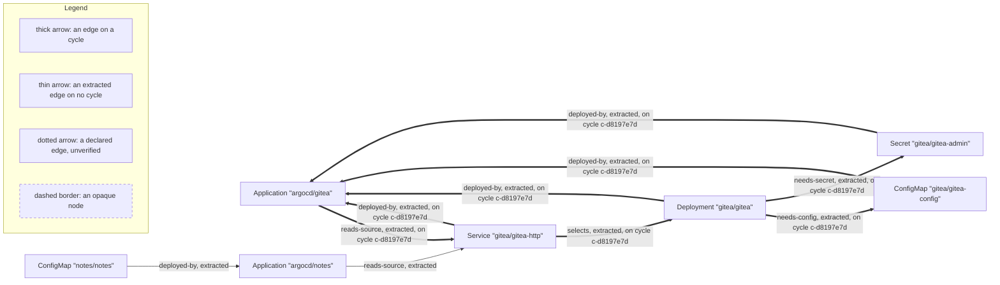

# Examples: every case, run for real

Each example here is a small estate in [`examples/`](../examples), written for crankpath (none is copied from another project), with the exact command and the output it gives. Nothing below was typed by hand: every output block is the pinned output of a real run, and `npm run verify` runs every example again with the built CLI and compares stdout, stderr and the exit code byte for byte (`test/examples/examples.test.ts`). A change to crankpath that changes what an example shows fails the build until the example is pinned again.

How to read this page:

- `crankpath` in a command stands for `node dist/u9-cli-package/cli.js`, run from the repository root after `npm run build`. The package is not published yet, so every run is of the built checkout.
- Every run was made with node alone on `PATH`, so the second line says `toolchain: helm not found on PATH, kustomize not found on PATH`. No example renders a chart or a Kustomize root, so with helm and kustomize installed only that line changes (and the `toolchain` object of a JSON report): checked on 2026-11-16 with helm v4.3.2 and kustomize v5.8.1 over every run. To reproduce an output byte for byte, run it as the test does: `env PATH="$(dirname "$(command -v node)")" node dist/u9-cli-package/cli.js <args>`.
- What each run must show was written in [`examples/expected.json`](../examples/expected.json) before its first run: the exit code and facts about stdout and stderr (whole lines, substrings, text that must be absent). The pinned output is kept in `examples/<example>/expected/<run>.stdout` and `.stderr`, written by `node scripts/examples.mjs --pin` only from a run that met every written fact. Where a first run showed a fact was wrong, or an estate was changed after its first run, `expected.json` keeps the change in its `edits` list with the reason (one estate change altered what its example shows: [below](#opaque-and-limit-outcomes)).
- The examples run offline: none reads the network, none needs helm or kustomize, and none touches a cluster (crankpath never does).
- The repository URLs (`http://gitea-http.gitea:3000/ops/...`, `https://github.com/example-org/...`) are examples; nothing is fetched. `--repo-url` tells crankpath which URL names the scanned checkout.

Contents: [the thin-slice cycle](#the-thin-slice-cycle), [cranked and uncranked](#cranked-and-uncranked), [`declared (unverified)`](#declared-unverified-a-cycle-that-needs-a-declared-edge), [reachability and the plan](#reachability-and-the-restoration-plan), [opaque and limit outcomes](#opaque-and-limit-outcomes), [exit codes](#every-exit-code), [refusals](#refusals-and-hostile-names), [Mermaid](#mermaid-output), [`--explain`](#--explain), [`--no-color` and `NO_COLOR`](#--no-color-and-no_color), [the homelab golden](#the-homelab-golden-ids-and-counts-only).

## The thin-slice cycle

`examples/thin-slice/repo`: an Argo CD Application `argocd/gitea` deploys Gitea from `platform/gitea` (a Deployment, its Service, a ConfigMap and a Secret) and reads its own Git source from that Gitea's Service; a second Application `argocd/notes` reads from the same Gitea. Every edge comes from a field of the files (`extracted`).

<!-- claim CL-41 -->
Output of `crankpath examples/thin-slice/repo --repo-url http://gitea-http.gitea:3000/ops/thin-slice`, run 2026-11-16, exit 0: <!-- example-output: thin-slice/text -->
```text
crankpath 0.1.0
toolchain: helm not found on PATH, kustomize not found on PATH
scanned: repo "http://gitea-http.gitea:3000/ops/thin-slice" (from --repo-url)
    commit: not read in this build  floating: no
Run status: ANALYSED

Opacity: 0 of 2 sources opaque (0%); sources are Applications, ApplicationSets,
    Kustomizations, HelmReleases and Kustomize roots; 0 files unreadable.
  found: 2 Applications, 0 ApplicationSets, 0 Kustomizations, 0 HelmReleases, 0
      Kustomize roots; 4 files hold no source document
  (nothing opaque, nothing skipped)

Cycles: 1 uncranked
  cycle c-d8197e7d  label: extracted  nodes: 5  edges: 8
    Application "argocd/gitea" reads source from Service "gitea/gitea-http"
        [field: "spec.source.repoURL"]
    Service "gitea/gitea-http" deployed by Application "argocd/gitea"
        [field: "spec.source.path"]
    shortest cycle shown; 6 more edges of this component are listed in the JSON
        output

Not startable from a cold start: 7 of 7 nodes (7 blocked, 0 unverified); 0
    startable
  blocked by cycle c-d8197e7d (extracted): 7 nodes
    Application "argocd/gitea"
    Application "argocd/notes"  via Service "gitea/gitea-http"
    ConfigMap "gitea/gitea-config"
    ConfigMap "notes/notes"  via Application "argocd/notes"
    Deployment "gitea/gitea"
    Secret "gitea/gitea-admin"
    Service "gitea/gitea-http"
  unresolved items: 0

External preconditions: none declared in crankpath.yaml and none extracted from
    what was read.

Plan (an order, not a schedule; cold-load pickup is not modelled): no steps,
    because no node is startable; the 7 nodes not startable are listed above.
  Assumed, not verified by crankpath: 0 externals declared available; 0
      externals served by an in-estate node; 0 cranks (documented); 0 match
      entries; 0 objects every cluster provides; and the 5 not-modelled items
      below. Every start step is relative to these and to the edges read.

Not verified: 1 cycle uncranked. Declared edges: 0 (unverified when present).
Not modelled (5 items): a running Argo CD or Flux controller is assumed;
    dependencies only visible at runtime are not seen; the content of opaque
    nodes is not seen; the revision each Application names is taken to be the
    files as read; repository credentials not defined in the estate are not
    seen.
```

What it shows: one strongly connected component, cycle `c-d8197e7d`, labelled `extracted` because every edge on it was read from a field; the shortest cycle through it is printed with the field of each edge. Every node is blocked from a cold start, so the plan has no steps and says why. A cycle is a finding, not an error: the exit code is 0. <!-- claim CL-41 -->

The same run as JSON (`--format json`, schema version 1, [`docs/json-output.md`](json-output.md)). Only the `cycles` block is shown here; the whole report is [`examples/thin-slice/expected/json.stdout`](../examples/thin-slice/expected/json.stdout).

<!-- claim CL-41 -->
The `cycles` block of `crankpath examples/thin-slice/repo --repo-url http://gitea-http.gitea:3000/ops/thin-slice --format json`, run 2026-11-16, exit 0: <!-- example-output: thin-slice/json key cycles -->
```text
  "cycles": [
    {
      "crankedBy": [],
      "edges": [
        {
          "from": "Application/argocd/gitea",
          "kind": "reads-source",
          "source": "extracted",
          "to": "Service/gitea/gitea-http"
        },
        {
          "from": "ConfigMap/gitea/gitea-config",
          "kind": "deployed-by",
          "source": "extracted",
          "to": "Application/argocd/gitea"
        },
        {
          "from": "Deployment/gitea/gitea",
          "kind": "deployed-by",
          "source": "extracted",
          "to": "Application/argocd/gitea"
        },
        {
          "from": "Deployment/gitea/gitea",
          "kind": "needs-config",
          "source": "extracted",
          "to": "ConfigMap/gitea/gitea-config"
        },
        {
          "from": "Deployment/gitea/gitea",
          "kind": "needs-secret",
          "source": "extracted",
          "to": "Secret/gitea/gitea-admin"
        },
        {
          "from": "Secret/gitea/gitea-admin",
          "kind": "deployed-by",
          "source": "extracted",
          "to": "Application/argocd/gitea"
        },
        {
          "from": "Service/gitea/gitea-http",
          "kind": "deployed-by",
          "source": "extracted",
          "to": "Application/argocd/gitea"
        },
        {
          "from": "Service/gitea/gitea-http",
          "kind": "selects",
          "source": "extracted",
          "to": "Deployment/gitea/gitea"
        }
      ],
      "id": "c-d8197e7d",
      "introducedBy": [],
      "label": "extracted",
      "labelBeforeCranks": "extracted",
      "nodes": [
        "Application/argocd/gitea",
        "ConfigMap/gitea/gitea-config",
        "Deployment/gitea/gitea",
        "Secret/gitea/gitea-admin",
        "Service/gitea/gitea-http"
      ],
      "representative": [
        "Application/argocd/gitea",
        "Service/gitea/gitea-http"
      ],
      "residual": null,
      "residualLabel": null,
      "touchedBy": []
    }
  ],
```

## Cranked and uncranked

The same estate with and without [`examples/crank/crankpath.yaml`](../examples/crank/crankpath.yaml), passed with `--config`: it declares `github.com` available during a black start and one crank, the manual step of the first install that points `argocd/gitea` at the GitHub copy. Without the file, the run is the thin-slice output above (the test holds the two byte-identical). With it:

<!-- claim CL-41 -->
Output of `crankpath examples/thin-slice/repo --repo-url http://gitea-http.gitea:3000/ops/thin-slice --config examples/crank/crankpath.yaml`, run 2026-11-16, exit 0: <!-- example-output: crank/cranked -->
```text
crankpath 0.1.0
toolchain: helm not found on PATH, kustomize not found on PATH
scanned: repo "http://gitea-http.gitea:3000/ops/thin-slice" (from --repo-url)
    commit: not read in this build  floating: no
Run status: ANALYSED

Opacity: 0 of 2 sources opaque (0%); sources are Applications, ApplicationSets,
    Kustomizations, HelmReleases and Kustomize roots; 0 files unreadable.
  found: 2 Applications, 0 ApplicationSets, 0 Kustomizations, 0 HelmReleases, 0
      Kustomize roots; 4 files hold no source document
  (nothing opaque, nothing skipped)

Cycles: 0 uncranked, 1 cranked
  cycle c-d8197e7d  label: cranked (was extracted)  nodes: 5  edges: 8
    cranked by: crank 1
        by: "first install: point Application argocd/gitea at the GitHub copy, sync, then switch it back to Gitea"
        (documented, not verified)
    Application "argocd/gitea" reads source from Service "gitea/gitea-http"
        [field: "spec.source.repoURL"]
    Service "gitea/gitea-http" deployed by Application "argocd/gitea"
        [field: "spec.source.path"]
    shortest cycle shown; 6 more edges of this component are listed in the JSON
        output

Not startable from a cold start: 0 of 7 nodes; 7 startable, relative to the
    assumptions under the plan
  unresolved items: 0

External preconditions (declared cold-start availability):
  external "github.com"  available (declared, not verified)

Plan (an order, not a schedule; cold-load pickup is not modelled): 7 steps
  step 1  manual  crank 1
      by: "first install: point Application argocd/gitea at the GitHub copy, sync, then switch it back to Gitea"
    reroutes: Application "argocd/gitea" to external "github.com"
  step 2  start   Application "argocd/gitea"
  step 3  start   ConfigMap "gitea/gitea-config", Secret "gitea/gitea-admin"
  step 4  start   Deployment "gitea/gitea"
  step 5  start   Service "gitea/gitea-http"
  step 6  start   Application "argocd/notes"
  step 7  start   ConfigMap "notes/notes"
  Assumed, not verified by crankpath: 1 external declared available; 0 externals
      served by an in-estate node; 1 crank (documented); 0 match entries; 0
      objects every cluster provides; and the 5 not-modelled items below. Every
      start step is relative to these and to the edges read.

Not verified: 1 external declared in crankpath.yaml (not verified); 1 crank
    documented (not verified). Declared edges: 0 (unverified when present).
Not modelled (5 items): a running Argo CD or Flux controller is assumed;
    dependencies only visible at runtime are not seen; the content of opaque
    nodes is not seen; the revision each Application names is taken to be the
    files as read; repository credentials not defined in the estate are not
    seen.
```

What changes: the same cycle `c-d8197e7d` is now `cranked (was extracted)` and names the crank that breaks it, quoted as written and marked `documented, not verified`; every node is startable relative to the plan's assumptions; and the plan has seven steps, the first the one manual step. The run is still `ANALYSED`: a crank and a declared external are assumptions, always listed under the plan, not gaps in what was read. <!-- claim CL-41 -->

## `declared (unverified)`: a cycle that needs a declared edge

`examples/declared/repo`: Vault (a StatefulSet and its Service) gets its TLS certificate from a cert-manager Issuer that asks Vault itself (`spec.vault.server`). Vault reads the certificate's Secret through a CSI volume, so no field of the files names that dependency, and crankpath does not see it:

<!-- claim CL-41 -->
Output of `crankpath examples/declared/repo --repo-url https://github.com/example-org/declared`, run 2026-11-16, exit 0: <!-- example-output: declared/without-edge -->
```text
crankpath 0.1.0
toolchain: helm not found on PATH, kustomize not found on PATH
scanned: repo "https://github.com/example-org/declared" (from --repo-url)
    commit: not read in this build  floating: no
Run status: ANALYSED WITH GAPS
  gaps: 1 unresolved item

Opacity: 0 of 1 source opaque (0%); sources are Applications, ApplicationSets,
    Kustomizations, HelmReleases and Kustomize roots; 0 files unreadable.
  found: 1 Application, 0 ApplicationSets, 0 Kustomizations, 0 HelmReleases, 0
      Kustomize roots; 3 files hold no source document
  (nothing opaque, nothing skipped)

Cycles: none found among 8 nodes and 11 edges read (0 nodes opaque; 1 unresolved
    item)

Not startable from a cold start: 7 of 7 nodes (7 blocked, 0 unverified); 0
    startable
  blocked by external "github.com" (UNRESOLVED: its cold start is not
      declared): 7 nodes
    Application "argocd/vault"  via external "github.com"
    Certificate "vault/vault-tls"  via Application "argocd/vault"
    Issuer "vault/vault-issuer"  via Application "argocd/vault"
    Secret "vault/vault-tls"  via Certificate "vault/vault-tls"
    Secret "vault/vault-token"  via Application "argocd/vault"
    Service "vault/vault"  via Application "argocd/vault"
    StatefulSet "vault/vault"  via Application "argocd/vault"
  unresolved items: 1
  unresolved 1 of 1  why: external-unspecified  subject: external "github.com"
    where: "crankpath.yaml"

External preconditions (declared cold-start availability):
  external "github.com"  UNRESOLVED (not declared in crankpath.yaml)

Plan (an order, not a schedule; cold-load pickup is not modelled): no steps,
    because no node is startable; the 7 nodes not startable are listed above.
  Assumed, not verified by crankpath: 0 externals declared available; 0
      externals served by an in-estate node; 0 cranks (documented); 0 match
      entries; 0 objects every cluster provides; and the 5 not-modelled items
      below. Every start step is relative to these and to the edges read.

Not verified: 1 unresolved item; 1 external unspecified. Declared edges: 0
    (unverified when present).
Not modelled (5 items): a running Argo CD or Flux controller is assumed;
    dependencies only visible at runtime are not seen; the content of opaque
    nodes is not seen; the revision each Application names is taken to be the
    files as read; repository credentials not defined in the estate are not
    seen.
```

[`examples/declared/crankpath.yaml`](../examples/declared/crankpath.yaml) declares the edge (with its reason) and declares `github.com` available:

<!-- claim CL-41 -->
Output of `crankpath examples/declared/repo --repo-url https://github.com/example-org/declared --config examples/declared/crankpath.yaml`, run 2026-11-16, exit 0: <!-- example-output: declared/with-edge -->
```text
crankpath 0.1.0
toolchain: helm not found on PATH, kustomize not found on PATH
scanned: repo "https://github.com/example-org/declared" (from --repo-url)
    commit: not read in this build  floating: no
Run status: ANALYSED WITH GAPS
  gaps: 1 declared fact changes the graph read (crankpath.yaml, not verified)

Opacity: 0 of 1 source opaque (0%); sources are Applications, ApplicationSets,
    Kustomizations, HelmReleases and Kustomize roots; 0 files unreadable.
  found: 1 Application, 0 ApplicationSets, 0 Kustomizations, 0 HelmReleases, 0
      Kustomize roots; 3 files hold no source document
  (nothing opaque, nothing skipped)

Cycles: 1 uncranked
  cycle c-c5fcc8eb  label: declared (unverified)  nodes: 5  edges: 5
    Certificate "vault/vault-tls" issued by Issuer "vault/vault-issuer"
        [field: "spec.issuerRef.name"]
    Issuer "vault/vault-issuer" depends on Service "vault/vault"
        [field: "spec.vault.server"]
    Service "vault/vault" selects StatefulSet "vault/vault"
        [field: "spec.selector"]
    StatefulSet "vault/vault" depends on Secret "vault/vault-tls"
        [field: "edges[0]"]  (declared, unverified)
    Secret "vault/vault-tls" produced by Certificate "vault/vault-tls"
        [field: "spec.secretName"]

Not startable from a cold start: 5 of 7 nodes (5 blocked, 0 unverified); 2
    startable
  blocked by cycle c-c5fcc8eb (declared (unverified)): 5 nodes
    Certificate "vault/vault-tls"
    Issuer "vault/vault-issuer"
    Secret "vault/vault-tls"
    Service "vault/vault"
    StatefulSet "vault/vault"
  unresolved items: 0

External preconditions (declared cold-start availability):
  external "github.com"  available (declared, not verified)

Plan (an order, not a schedule; cold-load pickup is not modelled): 2 steps
  step 1  start   Application "argocd/vault"
  step 2  start   Secret "vault/vault-token"
  not ordered: 5 nodes blocked or unverified, listed under Not startable from a
      cold start
  Assumed, not verified by crankpath: 1 external declared available; 0 externals
      served by an in-estate node; 0 cranks (documented); 0 match entries; 0
      objects every cluster provides; and the 5 not-modelled items below. Every
      start step is relative to these and to the edges read.

Not verified: 1 cycle uncranked; 1 external declared in crankpath.yaml (not
    verified). Declared edges: 1 (unverified when present).
Not modelled (5 items): a running Argo CD or Flux controller is assumed;
    dependencies only visible at runtime are not seen; the content of opaque
    nodes is not seen; the revision each Application names is taken to be the
    files as read; repository credentials not defined in the estate are not
    seen.
```

The cycle `c-c5fcc8eb` rests on the declared edge, so it is labelled `declared (unverified)`, never presented as proven; the edge is marked `(declared, unverified)` where it is printed; and the declared edge is a gap of the run (`ANALYSED WITH GAPS`), because it changes the graph crankpath read. <!-- claim CL-41 -->

## Reachability and the restoration plan

`examples/plan/repo`: the thin slice's Gitea plus two more Applications served from it, a Postgres StatefulSet with its Secret and Service, and a wiki whose TLS Secret comes from a self-signed cert-manager Issuer. [`examples/plan/crankpath.yaml`](../examples/plan/crankpath.yaml) is the crank file of the previous section.

<!-- claim CL-41 -->
Output of `crankpath examples/plan/repo --repo-url http://gitea-http.gitea:3000/ops/plan --config examples/plan/crankpath.yaml`, run 2026-11-16, exit 0: <!-- example-output: plan/text -->
```text
crankpath 0.1.0
toolchain: helm not found on PATH, kustomize not found on PATH
scanned: repo "http://gitea-http.gitea:3000/ops/plan" (from --repo-url)
    commit: not read in this build  floating: no
Run status: ANALYSED

Opacity: 0 of 3 sources opaque (0%); sources are Applications, ApplicationSets,
    Kustomizations, HelmReleases and Kustomize roots; 0 files unreadable.
  found: 3 Applications, 0 ApplicationSets, 0 Kustomizations, 0 HelmReleases, 0
      Kustomize roots; 5 files hold no source document
  (nothing opaque, nothing skipped)

Cycles: 0 uncranked, 1 cranked
  cycle c-d8197e7d  label: cranked (was extracted)  nodes: 5  edges: 8
    cranked by: crank 1
        by: "first install: point Application argocd/gitea at the GitHub copy, sync, then switch it back to Gitea"
        (documented, not verified)
    Application "argocd/gitea" reads source from Service "gitea/gitea-http"
        [field: "spec.source.repoURL"]
    Service "gitea/gitea-http" deployed by Application "argocd/gitea"
        [field: "spec.source.path"]
    shortest cycle shown; 6 more edges of this component are listed in the JSON
        output

Not startable from a cold start: 0 of 16 nodes; 16 startable, relative to the
    assumptions under the plan
  unresolved items: 0

External preconditions (declared cold-start availability):
  external "github.com"  available (declared, not verified)

Plan (an order, not a schedule; cold-load pickup is not modelled): 11 steps
  step 1  manual  crank 1
      by: "first install: point Application argocd/gitea at the GitHub copy, sync, then switch it back to Gitea"
    reroutes: Application "argocd/gitea" to external "github.com"
  step 2  start   Application "argocd/gitea"
  step 3  start   ConfigMap "gitea/gitea-config", Secret "gitea/gitea-admin"
  step 4  start   Deployment "gitea/gitea"
  step 5  start   Service "gitea/gitea-http"
  step 6  start   Application "argocd/db", Application "argocd/wiki"
  step 7  start   ConfigMap "wiki/wiki-config", Issuer "wiki/selfsigned",
      Secret "db/postgres-auth"
  step 8  start   Certificate "wiki/wiki-tls", StatefulSet "db/postgres"
  step 9  start   Secret "wiki/wiki-tls", Service "db/postgres"
  step 10  start   Deployment "wiki/wiki"
  step 11  start   Service "wiki/wiki"
  Assumed, not verified by crankpath: 1 external declared available; 0 externals
      served by an in-estate node; 1 crank (documented); 0 match entries; 0
      objects every cluster provides; and the 5 not-modelled items below. Every
      start step is relative to these and to the edges read.

Not verified: 1 external declared in crankpath.yaml (not verified); 1 crank
    documented (not verified). Declared edges: 0 (unverified when present).
Not modelled (5 items): a running Argo CD or Flux controller is assumed;
    dependencies only visible at runtime are not seen; the content of opaque
    nodes is not seen; the revision each Application names is taken to be the
    files as read; repository credentials not defined in the estate are not
    seen.
```

Every one of the 16 nodes is startable relative to the assumptions, and the plan orders them in 11 steps: step 1 is the manual crank, then each start step holds what has everything it needs from the steps before it (the Issuer before its Certificate, the Certificate before the Secret it produces, the Secret before the Deployment that mounts it). It is an order, not a schedule, as its first line says. The same run as JSON lists nothing unordered (`"listedUnordered": []`, asserted by the test on [`examples/plan/expected/json.stdout`](../examples/plan/expected/json.stdout)).

## Opaque and limit outcomes

`examples/opaque/repo` holds three things crankpath cannot see into, each named and counted:

- `argocd/mirror` reads from a mirror of this same repository on the in-cluster Gitea. No mapping says the two URLs name one repository, so crankpath does not read it (`unreadable-repo`) and prints the `repos:` entry that would read it, as a suggestion it never applies.
- A Flux HelmRelease takes its values from a Secret encrypted with sops (`encrypted-values`): what the values would make the chart depend on is not seen.
- `platform/web/aliases.yaml`, under `argocd/web`'s source path, is an alias bomb whose expansion is far over the limit of expanded nodes per document ([limits](limits.md)). The file is refused by name, never expanded; the Application whose files it could not all read is opaque `limit`, and the opacity line becomes a floor (`at least`).

<!-- claim CL-41 -->
Output of `crankpath examples/opaque/repo --repo-url https://github.com/example-org/opaque`, run 2026-11-16, exit 0: <!-- example-output: opaque/text -->
```text
crankpath 0.1.0
toolchain: helm not found on PATH, kustomize not found on PATH
scanned: repo "https://github.com/example-org/opaque" (from --repo-url)
    commit: not read in this build  floating: no
Run status: ANALYSED WITH GAPS
  gaps: 3 sources opaque; 1 file unreadable; 3 unresolved items

Opacity: at least 3 of 4 sources opaque (at least 75%); sources are
    Applications, ApplicationSets, Kustomizations, HelmReleases and Kustomize
    roots; 1 file unreadable.
  found: 3 Applications, 0 ApplicationSets, 0 Kustomizations, 1 HelmRelease, 0
      Kustomize roots; 1 file holds no source document
  opaque 1 of 3  node: Application "argocd/mirror"  reason: unreadable-repo
    could not see: objects under its source path
    field: "spec.source.repoURL"
        value: "http://gitea-http.gitea:3000/ops/opaque"  (not this repository
        and not mapped)
    suggested repos entry (not
        applied): "http://gitea-http.gitea:3000/ops/opaque": {read_from: .}
  opaque 2 of 3  node: Application "argocd/web"  reason: limit
    could not see: objects in the files it could not read
    field: "spec.source.path"  (1 file under its source path not read)
  opaque 3 of 3  node: HelmRelease "monitoring/monitoring"
      reason: encrypted-values
    could not see: edges from inside values
    field: "spec.valuesFrom[0].name"  (the Secret is encrypted (sops) and is not
        read)
  unreadable 1 of 1  file: "platform/web/aliases.yaml"  (alias expansion over
      the limit)

Cycles: none found among 10 nodes and 11 edges read (3 nodes opaque, so cycles
    inside them cannot be seen; 3 unresolved items; 1 file unreadable)

Not startable from a cold start: 8 of 8 nodes (7 blocked, 1 unverified); 0
    startable
  blocked by external "charts.example.org" (UNRESOLVED: its cold start is not
      declared): 2 nodes
    HelmRelease "monitoring/monitoring"  via HelmRepository "flux-system/charts"
    HelmRepository "flux-system/charts"  via external "charts.example.org"
  blocked by external "github.com" (UNRESOLVED: its cold start is not
      declared): 5 nodes
    Application "argocd/monitoring"  via external "github.com"
    Application "argocd/web"  via external "github.com"
    Deployment "web/web"  via Application "argocd/web"
    Secret "monitoring/monitoring-values"  via Application "argocd/monitoring"
    Service "web/web"  via Application "argocd/web"
  unverified, opaque or behind opaque Application "argocd/mirror": 1 node
    Application "argocd/mirror"
  unresolved items: 3
  unresolved 1 of 3  why: host-unplaced  subject: Application "argocd/mirror"
    where: "apps/mirror.yaml#1"  field: "spec.source.repoURL"
        host: "gitea-http.gitea"
  unresolved 2 of 3  why: external-unspecified
      subject: external "charts.example.org"
    where: "crankpath.yaml"
  unresolved 3 of 3  why: external-unspecified  subject: external "github.com"
    where: "crankpath.yaml"

External preconditions (declared cold-start availability):
  external "charts.example.org"  UNRESOLVED (not declared in crankpath.yaml)
  external "github.com"  UNRESOLVED (not declared in crankpath.yaml)

Plan (an order, not a schedule; cold-load pickup is not modelled): no steps,
    because no node is startable; the 8 nodes not startable are listed above.
  Assumed, not verified by crankpath: 0 externals declared available; 0
      externals served by an in-estate node; 0 cranks (documented); 0 match
      entries; 0 objects every cluster provides; and the 5 not-modelled items
      below. Every start step is relative to these and to the edges read.

Not verified: 3 sources opaque; 1 file unreadable; 3 unresolved items; 1 node
    unverified; 2 externals unspecified. Declared edges: 0 (unverified when
    present).
Not modelled (5 items): a running Argo CD or Flux controller is assumed;
    dependencies only visible at runtime are not seen; the content of opaque
    nodes is not seen; the revision each Application names is taken to be the
    files as read; repository credentials not defined in the estate are not
    seen.
```

The JSON report names each outcome by its word; its `unreadable` block:

<!-- claim CL-41 -->
The `unreadable` block of `crankpath examples/opaque/repo --repo-url https://github.com/example-org/opaque --format json`, run 2026-11-16, exit 0: <!-- example-output: opaque/json key unreadable -->
```text
  "unreadable": [
    {
      "detail": null,
      "outcome": "alias-limit",
      "path": "platform/web/aliases.yaml",
      "reasonWord": "alias expansion over the limit"
    }
  ],
```

Two notes. The first run of this example (2026-11-16) showed the HelmRepository and the encrypted Secret as defined by no readable source, because nothing deployed `platform/monitoring`; the Application `argocd/monitoring` was added so the example shows what it is for, and the edit is recorded in `examples/expected.json`. And with no `crankpath.yaml`, `github.com` and `charts.example.org` have no declared cold start, so everything behind them is blocked and listed as unresolved, never assumed.

## Every exit code

crankpath exits 0 when it analysed the estate (with or without gaps, with or without cycles: a cycle is a finding), 1 on an input or usage error (nothing is analysed with a half-read input), and 2 when it found nothing to analyse.

Exit 0 is every analysed example on this page, the thin slice first. Exit 1, a `crankpath.yaml` at the root of `examples/exit-codes/bad-config` with a misspelt key:

<!-- claim CL-41 -->
Standard error of `crankpath examples/exit-codes/bad-config --repo-url https://github.com/example-org/bad-config`, run 2026-11-16, exit 1 (standard output is empty): <!-- example-output: exit-codes/exit-1-config stderr -->
```text
error: invalid crankpath.yaml at key path "cranks[0].reroute" (unknown key)
```

Exit 1, an unknown output format:

<!-- claim CL-41 -->
Standard error of `crankpath examples/thin-slice/repo --repo-url http://gitea-http.gitea:3000/ops/thin-slice --format yaml`, run 2026-11-16, exit 1 (standard output is empty): <!-- example-output: exit-codes/exit-1-usage stderr -->
```text
error: unknown format "yaml" (text, json or mermaid)
```

Exit 2, a directory holding a plain manifest and nothing that deploys it:

<!-- claim CL-41 -->
Output of `crankpath examples/exit-codes/nothing`, run 2026-11-16, exit 2: <!-- example-output: exit-codes/exit-2-nothing -->
```text
crankpath 0.1.0
Run status: NOTHING ANALYSED
path: "examples/exit-codes/nothing"  found: 0 Applications, 0 ApplicationSets, 0
    Kustomizations, 0 HelmReleases, 0 Kustomize roots; 1 file holds no source
    document
exit code 2
```

## Refusals and hostile names

`examples/refusals/repo` holds four things the scanned repository should never be able to do to crankpath:

- `platform/web/escape.yaml` is a symlink (to a file of another example). A symlink is never followed.
- `apps/docs.yaml` names a source path that climbs out of the scanned root (`../../outside`). Nothing outside the root is read.
- `platform/web/big.yaml` is one byte over the per-file size limit (10,000,000 bytes, [limits](limits.md)). A file that size does not belong in a repository, so [`examples/refusals/make-copy.mjs`](../examples/refusals/make-copy.mjs) copies the estate to a new directory and makes the file there, sparse (it takes almost no disk). crankpath refuses it from its size before reading a byte.
- `apps/hostile.yaml` and `platform/web/hostile.yaml` hold text that imitates crankpath's own output: a source path with newlines, a fake `Run status` line and terminal colour codes, and object names with screen-clearing escapes, a fake `Cycles:` heading and dot segments that spell another node's id.

The commands, run as the test runs them (`$TMPDIR` is the system temporary directory):

```sh
node examples/refusals/make-copy.mjs "$TMPDIR/refusals"
crankpath "$TMPDIR/refusals" --repo-url https://github.com/example-org/refusals
```

<!-- claim CL-41 -->
Output of `crankpath "$TMPDIR/refusals" --repo-url https://github.com/example-org/refusals`, run 2026-11-16 after `node examples/refusals/make-copy.mjs "$TMPDIR/refusals"`, exit 0: <!-- example-output: refusals/text -->
```text
crankpath 0.1.0
toolchain: helm not found on PATH, kustomize not found on PATH
scanned: repo "https://github.com/example-org/refusals" (from --repo-url)
    commit: not read in this build  floating: no
Run status: ANALYSED WITH GAPS
  gaps: 3 sources opaque; 2 files unreadable; 3 objects skipped; 1 unresolved
      item

Opacity: at least 3 of 3 sources opaque (at least 100%); sources are
    Applications, ApplicationSets, Kustomizations, HelmReleases and Kustomize
    roots; 2 files unreadable.
  found: 3 Applications, 0 ApplicationSets, 0 Kustomizations, 0 HelmReleases, 0
      Kustomize roots; 2 files hold no source document
  opaque 1 of 3  node: Application "argocd/docs"  reason: unreadable-file
    could not see: objects under its source path
    field: "spec.source.path"  value: "../../outside"  (outside the scanned
        root)
  opaque 2 of 3  node: Application "argocd/notes"  reason: unreadable-file
    could not see: objects under its source path
    field: "spec.source.path"
        value: "docs\x0aRun status: ANALYSED\x0a\x1b[32mOK no cycles found\x1b[0m"
        (not found)
  opaque 3 of 3  node: Application "argocd/web"  reason: limit
    could not see: objects in the files it could not read
    field: "spec.source.path"  (2 files under its source path not read)
  unreadable 1 of 2  file: "platform/web/big.yaml"  (too large)
  unreadable 2 of 2  file: "platform/web/escape.yaml"  (symlink, not followed)
  skipped 1 of 3  reason: invalid-name  kind: "ConfigMap"  namespace: "web"
      name: "web\x1b[2J\x1b[HRun status: ANALYSED"
    file: "platform/web/hostile.yaml"  document: 1
  skipped 2 of 3  reason: invalid-name  kind: "ConfigMap"  namespace: "web"
      name: "x/../../Service/web/web"
    file: "platform/web/hostile.yaml"  document: 2
  skipped 3 of 3  reason: invalid-name  kind: "ConfigMap"  namespace: "web"
      name: "line one\x0aCycles: 0"
    file: "platform/web/hostile.yaml"  document: 3

Cycles: none found among 6 nodes and 6 edges read (3 nodes opaque, so cycles
    inside them cannot be seen; 1 unresolved item; 3 objects skipped; 2 files
    unreadable)

Not startable from a cold start: 5 of 5 nodes (5 blocked, 0 unverified); 0
    startable
  blocked by external "github.com" (UNRESOLVED: its cold start is not
      declared): 5 nodes
    Application "argocd/docs"  via external "github.com"
    Application "argocd/notes"  via external "github.com"
    Application "argocd/web"  via external "github.com"
    Deployment "web/web"  via Application "argocd/web"
    Service "web/web"  via Application "argocd/web"
  unresolved items: 1
  unresolved 1 of 1  why: external-unspecified  subject: external "github.com"
    where: "crankpath.yaml"

External preconditions (declared cold-start availability):
  external "github.com"  UNRESOLVED (not declared in crankpath.yaml)

Plan (an order, not a schedule; cold-load pickup is not modelled): no steps,
    because no node is startable; the 5 nodes not startable are listed above.
  Assumed, not verified by crankpath: 0 externals declared available; 0
      externals served by an in-estate node; 0 cranks (documented); 0 match
      entries; 0 objects every cluster provides; and the 5 not-modelled items
      below. Every start step is relative to these and to the edges read.

Not verified: 3 sources opaque; 2 files unreadable; 3 objects skipped; 1
    unresolved item; 1 external unspecified. Declared edges: 0 (unverified when
    present).
Not modelled (5 items): a running Argo CD or Flux controller is assumed;
    dependencies only visible at runtime are not seen; the content of opaque
    nodes is not seen; the revision each Application names is taken to be the
    files as read; repository credentials not defined in the estate are not
    seen.
```

Each refusal is a named, counted outcome: the two files unreadable (`too large`, `symlink, not followed`), the climbing path opaque `unreadable-file` (`outside the scanned root`), the three names skipped `invalid-name`. Every piece of hostile text is printed after a fixed label, in quotes, with its control characters written out (`\x0a` for a newline, `\x1b` for an escape), so the output holds exactly one `Run status` line and one `Cycles` heading, both crankpath's (the test counts them). The output holds no escape byte at all.

## Mermaid output

`--format mermaid` writes a Markdown file: a short header, a ```` ```mermaid ```` diagram of every node and edge read (thick arrows for edges on a cycle, dotted for declared edges, a dashed border for opaque nodes) and a text fallback that lists the same nodes and edges, for a reader that cannot render the diagram. The screenshot of this output in the [tour](tour.md) is the diagram rendered by Mermaid itself, which also shows that it parses.

<!-- claim CL-41 -->
Output of `crankpath examples/thin-slice/repo --repo-url http://gitea-http.gitea:3000/ops/thin-slice --format mermaid`, run 2026-11-16, exit 0: <!-- example-output: mermaid/mermaid -->
````text
```text
crankpath 0.1.0
scanned: repo "http://gitea-http.gitea:3000/ops/thin-slice" (from --repo-url)
    commit: not read in this build  floating: no
Run status: ANALYSED
Cycles: 1 uncranked
drawn: the whole graph read (7 nodes, 10 edges)
```



```text
Text fallback: the nodes and edges drawn above.
nodes: 7
  n1  Application "argocd/gitea"
  n2  Application "argocd/notes"
  n3  ConfigMap "gitea/gitea-config"
  n4  ConfigMap "notes/notes"
  n5  Deployment "gitea/gitea"
  n6  Secret "gitea/gitea-admin"
  n7  Service "gitea/gitea-http"
edges: 10 (from -> to  kind  source)
  Application "argocd/gitea" -> Service "gitea/gitea-http"  reads-source
      extracted  cycle: c-d8197e7d
  Application "argocd/notes" -> Service "gitea/gitea-http"  reads-source
      extracted
  ConfigMap "gitea/gitea-config" -> Application "argocd/gitea"  deployed-by
      extracted  cycle: c-d8197e7d
  ConfigMap "notes/notes" -> Application "argocd/notes"  deployed-by  extracted
  Deployment "gitea/gitea" -> Application "argocd/gitea"  deployed-by  extracted
      cycle: c-d8197e7d
  Deployment "gitea/gitea" -> ConfigMap "gitea/gitea-config"  needs-config
      extracted  cycle: c-d8197e7d
  Deployment "gitea/gitea" -> Secret "gitea/gitea-admin"  needs-secret
      extracted  cycle: c-d8197e7d
  Secret "gitea/gitea-admin" -> Application "argocd/gitea"  deployed-by
      extracted  cycle: c-d8197e7d
  Service "gitea/gitea-http" -> Application "argocd/gitea"  deployed-by
      extracted  cycle: c-d8197e7d
  Service "gitea/gitea-http" -> Deployment "gitea/gitea"  selects  extracted
      cycle: c-d8197e7d
```
````

## `--explain`

`--explain` with no id prints the evidence behind every cycle: each edge with the file, the field and the rendered path it was read from, and the cycle's elementary cycles. `--explain <id>` does the same for one cycle or one node.

<!-- claim CL-41 -->
Output of `crankpath examples/thin-slice/repo --repo-url http://gitea-http.gitea:3000/ops/thin-slice --explain`, run 2026-11-16, exit 0: <!-- example-output: explain/cycles -->
```text
crankpath 0.1.0 explain: every cycle
scanned: repo "http://gitea-http.gitea:3000/ops/thin-slice" (from --repo-url)
    commit: not read in this build  floating: no
Run status: ANALYSED

cycle c-d8197e7d  label: extracted  nodes: 5  edges: 8
  nodes, numbered for the elementary cycles below:
    node 1  Application "argocd/gitea"
    node 2  ConfigMap "gitea/gitea-config"
    node 3  Deployment "gitea/gitea"
    node 4  Secret "gitea/gitea-admin"
    node 5  Service "gitea/gitea-http"
  evidence for the first 5 of 8 edges (file, field, rendered path, line); the
      other 3 are in the JSON output
    edge 1 of 8  Application "argocd/gitea" reads source from
        Service "gitea/gitea-http"  (reads-source, extracted)
      file: "apps/gitea.yaml"  line: not recorded
      field: "spec.source.repoURL"
      rendered path: "apps/gitea.yaml#1"
    edge 2 of 8  ConfigMap "gitea/gitea-config" deployed by
        Application "argocd/gitea"  (deployed-by, extracted)
      file: "apps/gitea.yaml"  line: not recorded
      field: "spec.source.path"
      rendered path: "platform/gitea/config.yaml#1"
    edge 3 of 8  Deployment "gitea/gitea" deployed by Application "argocd/gitea"
        (deployed-by, extracted)
      file: "apps/gitea.yaml"  line: not recorded
      field: "spec.source.path"
      rendered path: "platform/gitea/deployment.yaml#1"
    edge 4 of 8  Deployment "gitea/gitea" needs ConfigMap "gitea/gitea-config"
        (needs-config, extracted)
      file: "platform/gitea/deployment.yaml"  line: not recorded
      field: "spec.template.spec.containers[0].envFrom[0].configMapRef.name"
      rendered path: "platform/gitea/deployment.yaml#1"
    edge 5 of 8  Deployment "gitea/gitea" needs Secret "gitea/gitea-admin"
        (needs-secret, extracted)
      file: "platform/gitea/deployment.yaml"  line: not recorded
      field: "spec.template.spec.containers[0].env[0].valueFrom.secretKeyRef.name"
      rendered path: "platform/gitea/deployment.yaml#1"
  elementary cycles: 4, all of them (as node sequences; the bound is 21)
    path 1  node 1 -> node 5 -> node 1
    path 2  node 1 -> node 5 -> node 3 -> node 1
    path 3  node 1 -> node 5 -> node 3 -> node 2 -> node 1
    path 4  node 1 -> node 5 -> node 3 -> node 4 -> node 1
  self-management: none named (no source on this cycle renders an object
      matching the Argo CD or Flux controller signatures)
  nodes blocked by this cycle: 7 (the text report lists them under Not startable
      from a cold start)

Assumed, not verified by crankpath: 0 externals declared available; 0 externals
    served by an in-estate node; 0 cranks (documented); 0 match entries; 0
    objects every cluster provides; and the 5 not-modelled items below. Every
    start step is relative to these and to the edges read.
Not modelled (5 items): a running Argo CD or Flux controller is assumed;
    dependencies only visible at runtime are not seen; the content of opaque
    nodes is not seen; the revision each Application names is taken to be the
    files as read; repository credentials not defined in the estate are not
    seen.
```

For one node, here the Application the cycle blocks:

<!-- claim CL-41 -->
Output of `crankpath examples/thin-slice/repo --repo-url http://gitea-http.gitea:3000/ops/thin-slice --explain Application/argocd/notes`, run 2026-11-16, exit 0: <!-- example-output: explain/node -->
```text
crankpath 0.1.0 explain: "Application/argocd/notes"
scanned: repo "http://gitea-http.gitea:3000/ops/thin-slice" (from --repo-url)
    commit: not read in this build  floating: no
Run status: ANALYSED

node Application "argocd/notes"
  read from: file: "apps/notes.yaml"  document: 1  read directly from the
      repository
  status: blocked  reason: cycle  1 blocker: cycle c-d8197e7d  via
      Service "gitea/gitea-http"
  on a cycle: no
  dependencies: 1 edge, each with where it was read:
    edge 1 of 1  Application "argocd/notes" reads source from
        Service "gitea/gitea-http"  (reads-source, extracted)
      file: "apps/notes.yaml"  line: not recorded
      field: "spec.source.repoURL"
      rendered path: "apps/notes.yaml#1"
  dependents: 1 edge
    ConfigMap "notes/notes" deployed by it  (deployed-by, extracted)
  unresolved items on it: 0
  self-management: none named (it is on no cycle)
  plan: not ordered (blocked or unverified)

Assumed, not verified by crankpath: 0 externals declared available; 0 externals
    served by an in-estate node; 0 cranks (documented); 0 match entries; 0
    objects every cluster provides; and the 5 not-modelled items below. Every
    start step is relative to these and to the edges read.
Not modelled (5 items): a running Argo CD or Flux controller is assumed;
    dependencies only visible at runtime are not seen; the content of opaque
    nodes is not seen; the revision each Application names is taken to be the
    files as read; repository credentials not defined in the estate are not
    seen.
```

## `--no-color` and `NO_COLOR`

crankpath colours a few words (the run status, `uncranked`) only when standard output is a terminal. `--no-color` and the environment variable `NO_COLOR` (any value) turn colour off even on a terminal. Off a terminal there is never colour, so `crankpath examples/thin-slice/repo --repo-url http://gitea-http.gitea:3000/ops/thin-slice --no-color` and the same command with `NO_COLOR=1` print exactly the thin-slice output above (the two runs are pinned in [`examples/no-color/expected/`](../examples/no-color/expected), and the test holds all three byte-identical). On a pseudo-terminal the test also checks that the plain command writes colour codes and that the flag and the variable each remove them, leaving the same text; the [tour](tour.md) shows the three runs side by side.

## The homelab golden (ids and counts only)

khuedoan/homelab is GPL-3.0, so no file of it is copied here and no text of it is shown: the golden lane fetches it read-only at commit `8b9d40f` and keeps only node ids and counts (`npm run verify:golden`, which needs helm, kustomize and the network; `test/golden/homelab*/`). What its pinned reduced output says:

- Without a crank (`test/golden/homelab/`): `NOTHING ANALYSED`, exit 2. Nothing in the estate deploys `system/argocd`, whose chart renders the root ApplicationSet (the repository applies it by hand at bootstrap), and the 31 chart directories nothing deploys are listed with the suggestion to declare a crank. <!-- claim CL-42 -->
- With the bootstrap crank (`test/golden/homelab-cranked/crankpath.yaml`, crankpath's own text: the chart applied by hand, and the root ApplicationSet and its 31 Applications rerouted to `github.com`): 614 nodes and 793 edges, one strongly connected component `c-35843cd4` of 12 nodes and 22 edges holding both cycles of the research (Argo CD reads its Git from a Gitea that Argo CD deploys, and Argo CD manages itself), `cranked (was extracted)` by crank 1, which creates the chart's 54 objects; the plan has 8 steps, step 1 the manual crank; the run is `ANALYSED WITH GAPS`. <!-- claim CL-42 -->

The numbers are checked against the pinned files by `test/examples/examples.test.ts`; the lane itself runs only where helm, kustomize and the network are available, and is SKIPPED, never passed, without them.
