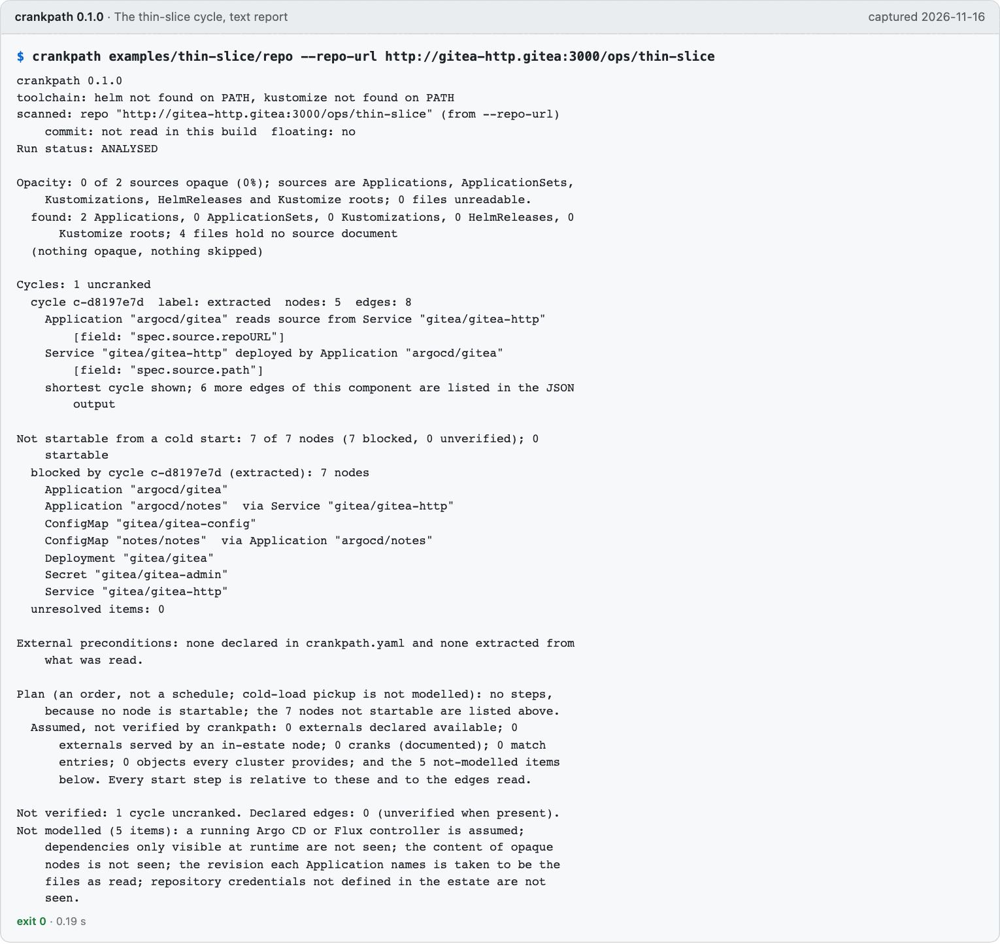
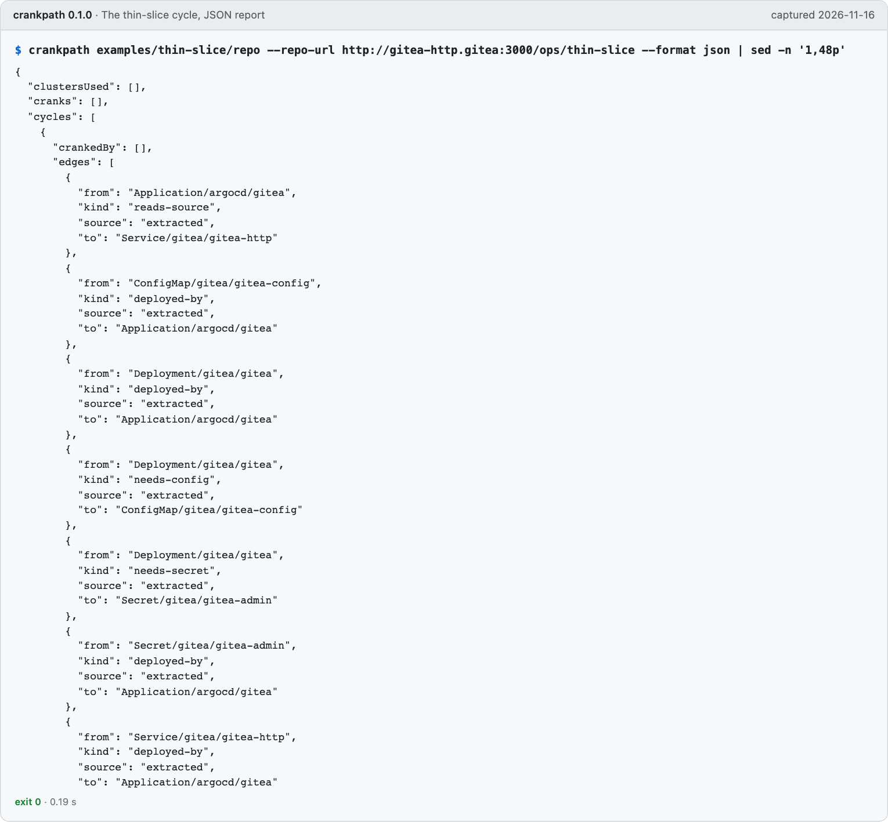
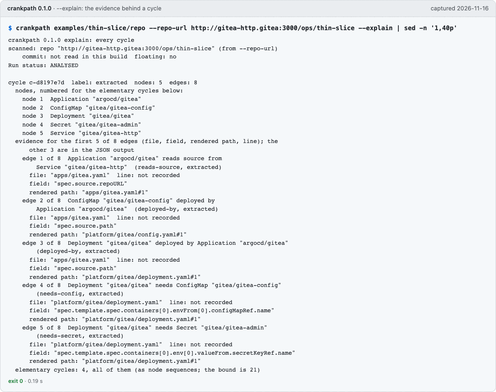
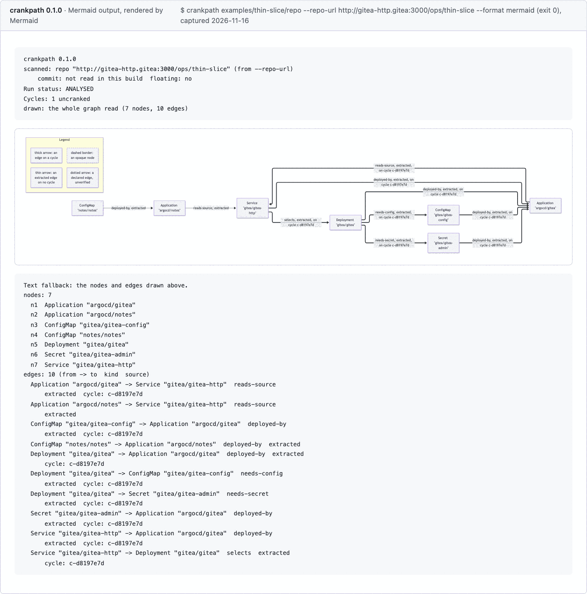
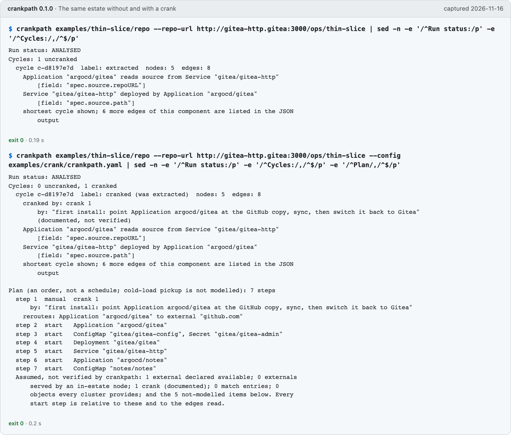
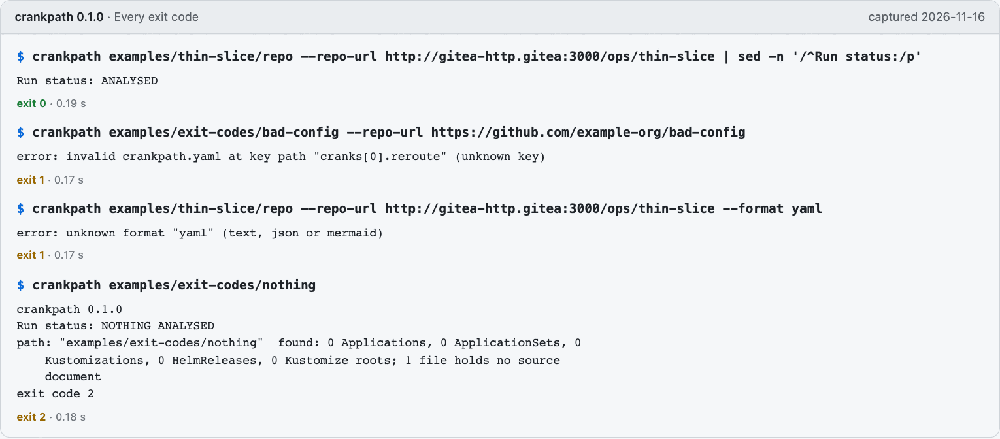
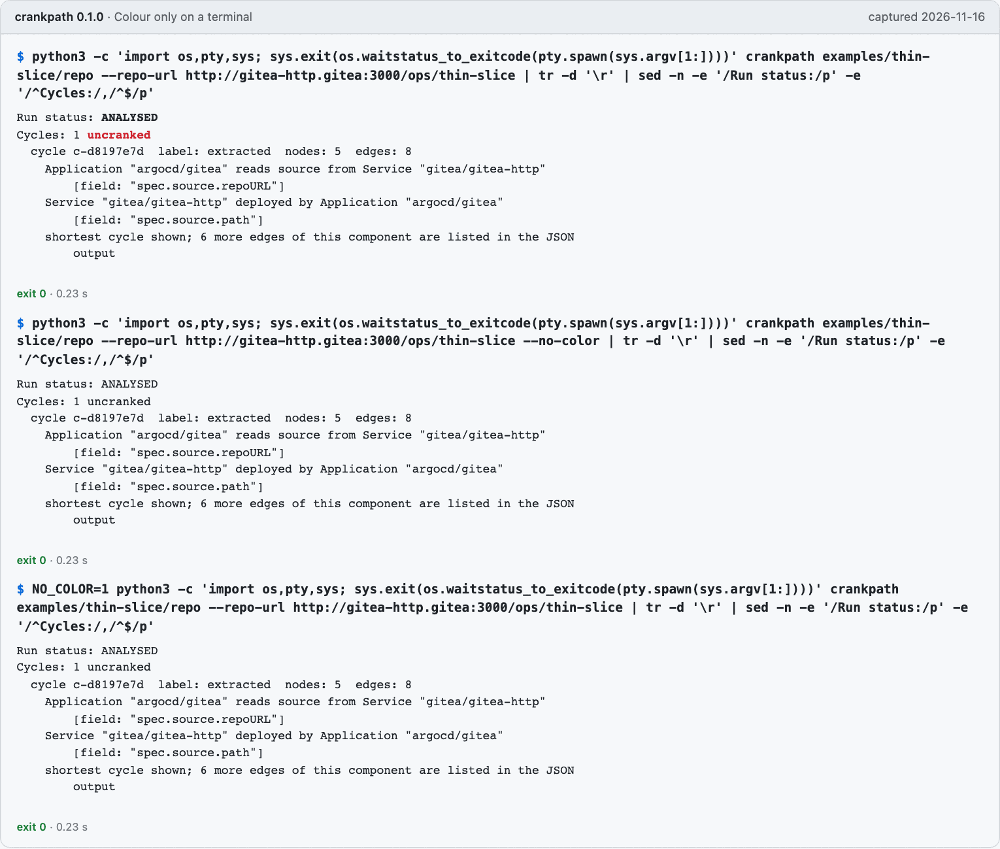
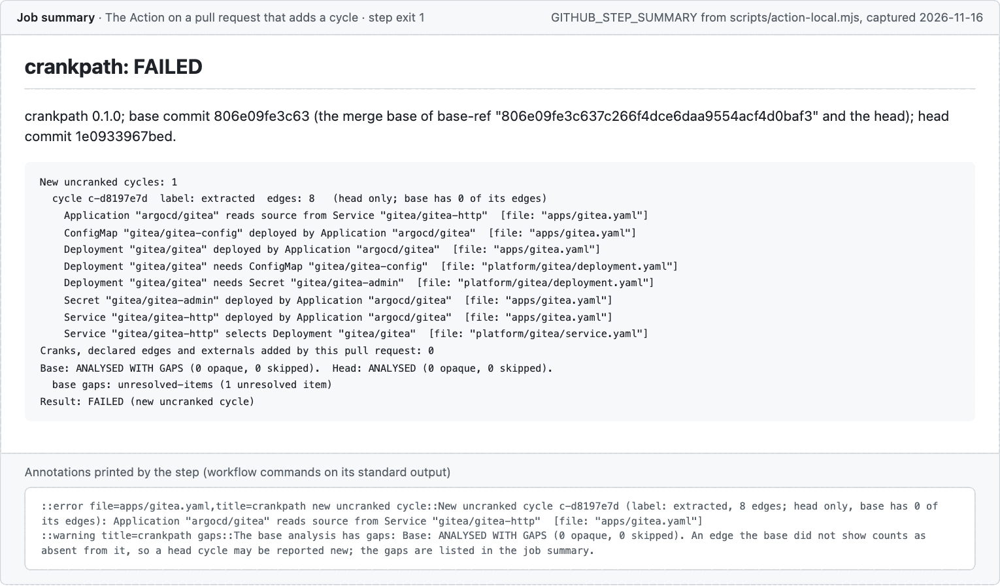
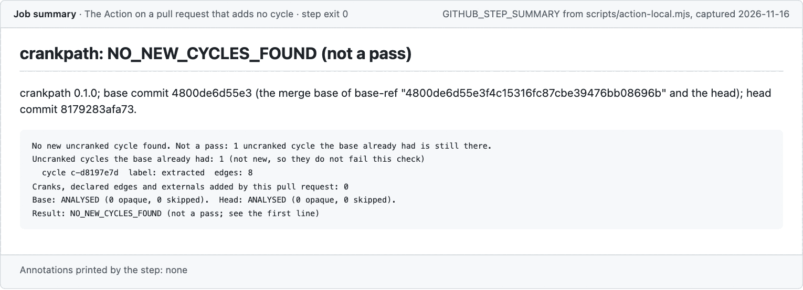

# A tour, with real output

Every image here is a screenshot of a command's real output, captured on 2026-11-16 with crankpath 0.1.0 built from this repository. Nothing in an image was typed by hand: [`docs/images/transcripts/`](images/transcripts) holds the captured text, and [`docs/images/README.md`](images/README.md) says how each image was made, with which versions, and what was left out (only the home and temporary directories are rewritten; every cut is a `sed` shown in the image). Each command was checked, when it was captured, against the output pinned for its example, so the images and [the examples](examples.md) show the same runs; the examples page has the full outputs and the estates.

In the images, `crankpath` is `node dist/u9-cli-package/cli.js`, run from the repository root after `npm run build`, with node alone on `PATH` besides `/usr/bin` and `/bin`: helm and kustomize are not found, and no example needs them.

The estates are crankpath's own small examples, written for it. They are demonstrations of what crankpath reports, not evidence about any real estate; step 13 is the one real repository, shown as ids and counts only.

## 1. Find the cycle

 <!-- claim CL-43 -->

*`crankpath examples/thin-slice/repo --repo-url http://gitea-http.gitea:3000/ops/thin-slice`, cut with `sed`, run 2026-11-16: Argo CD reads its Git source from the Gitea it deploys: one extracted cycle, every node blocked, and a status line that says ANALYSED only because everything was read.*

An Argo CD Application deploys Gitea and reads its own Git source from that Gitea's Service. crankpath reads the files (no cluster), finds the strongly connected component, prints the shortest cycle through it with the field each edge came from, and labels it `extracted` because every edge was read from a field. Nothing can start from a cold start, and the run still exits 0: a cycle is a finding, not an error. `ANALYSED` means every source was read; a run with anything unread says `ANALYSED WITH GAPS` and names the gaps (steps 7 to 9).

 <!-- claim CL-43 -->

*`crankpath examples/thin-slice/repo --repo-url http://gitea-http.gitea:3000/ops/thin-slice`, run 2026-11-16: The whole text report of the thin-slice example: what was read, the cycle, what it blocks, and what is assumed.*

The whole report, top to bottom: the toolchain and the scanned repository, the run status, the opacity line (what was read, counted by source), the cycles, what is not startable and why, the external preconditions, the plan, and the assumptions and the things crankpath does not model. Those last two blocks are on every report.

## 2. The same run as JSON

 <!-- claim CL-43 -->

*`crankpath examples/thin-slice/repo --repo-url http://gitea-http.gitea:3000/ops/thin-slice --format json | sed -n '1,48p'`, run 2026-11-16: The same run with --format json: the first 48 lines of the schema-version-1 report, the cycle with its edges.*

The JSON report is the stable contract (schema version 1, [`docs/json-output.md`](json-output.md)): keys and arrays sorted, no timestamps, no absolute paths, so the same inputs give the same bytes. Each edge carries whether it was `extracted` or `declared`.

## 3. Ask why

 <!-- claim CL-43 -->

*`crankpath examples/thin-slice/repo --repo-url http://gitea-http.gitea:3000/ops/thin-slice --explain | sed -n '1,40p'`, run 2026-11-16: --explain prints each edge of the cycle with the file, the field and the rendered path it was read from.*

`--explain` is the evidence trail: for each edge, the file, the field and the rendered path it was read from, so every claim in the report can be checked by opening one file. `--explain <id>` does the same for one cycle or one node ([examples](examples.md#--explain)).

## 4. Draw it

 <!-- claim CL-43 -->

*`crankpath examples/thin-slice/repo --repo-url http://gitea-http.gitea:3000/ops/thin-slice --format mermaid`, run 2026-11-16: --format mermaid on the thin slice, rendered by Mermaid 12.3.0 itself (which also shows that it parses), with crankpath's text fallback.*

`--format mermaid` writes Markdown that GitHub renders as a diagram: thick arrows for edges on a cycle, dotted for declared edges, a dashed border for opaque nodes, a legend, and a text fallback that lists the same nodes and edges. The image is Mermaid's own rendering of crankpath's output.

## 5. Write down the bootstrap step

 <!-- claim CL-43 -->

*The same command without and with `--config examples/crank/crankpath.yaml`, run 2026-11-16: Without crankpath.yaml the cycle is uncranked and nothing can start; with the crank file the same cycle is cranked, the crank is documented and not verified, and the plan starts with the one manual step.*

A crank is the manual step a person takes to break a cycle at bootstrap, written in `crankpath.yaml` ([the reference](crankpath-yaml.md#cranks), [writing them](write-your-cranks.md)). With it, the same cycle is labelled `cranked (was extracted)` and names the crank; the crank itself is printed as written, after a label, and marked `documented, not verified`: crankpath cannot check that the step works. The run stays `ANALYSED`, because a crank is an assumption of the plan, listed under it, not a gap in what was read.

## 6. Read the plan

 <!-- claim CL-43 -->

*`crankpath examples/plan/repo --repo-url http://gitea-http.gitea:3000/ops/plan --config examples/plan/crankpath.yaml`, cut with `sed`, run 2026-11-16: Every node is startable relative to the listed assumptions, and the plan orders all 16 in 11 steps, the first the one manual crank.*

The plan is an order, not a schedule: step 1 is the manual crank, and each start step holds what has everything it needs from the steps before it (the Issuer before its Certificate, the Certificate before the Secret it produces, the Secret before the Deployment that mounts it). It is relative to the assumptions printed under it: here one external declared available and one crank. Nothing is listed unordered in this estate; one that is gets a reason ([examples](examples.md#reachability-and-the-restoration-plan)).

## 7. What crankpath cannot prove

 <!-- claim CL-43 -->

*`crankpath examples/declared/repo --repo-url https://github.com/example-org/declared`, without and with `--config examples/declared/crankpath.yaml`, cut with `sed`, run 2026-11-16: No field shows that Vault reads its certificate's Secret, so without the declared edge crankpath finds none; with it, the cycle is labelled declared (unverified) and the run has a gap.*

Some dependencies are visible only at runtime (here, a Secret mounted through a CSI driver). Without the declared edge, crankpath says it found none among the nodes and edges it read; with it, the cycle is labelled `declared (unverified)` and the run has a gap, because a declared edge changes the graph crankpath read. A cycle that rests on a declared edge is never shown as proven.

## 8. What crankpath cannot read

 <!-- claim CL-43 -->

*`crankpath examples/opaque/repo --repo-url https://github.com/example-org/opaque`, cut with `sed`, run 2026-11-16: An unreadable repository with its suggested entry (never applied), encrypted values, and an alias bomb refused by the limit: each named and counted, and the opacity line a floor.*

Each source crankpath cannot see into is opaque, with a fixed reason: a repository URL that no mapping says is this repository (`unreadable-repo`, with the `repos:` entry that would read it, printed and never applied), values encrypted with sops (`encrypted-values`), a file refused by a limit (`limit`). The opacity line counts them, and says `at least` when a file was unreadable, because what that file would have added is not known.

## 9. Hostile input

 <!-- claim CL-43 -->

*`node examples/refusals/make-copy.mjs "$TMPDIR/crankpath-shots/refusals"`, then `crankpath "$TMPDIR/crankpath-shots/refusals" --repo-url https://github.com/example-org/refusals`, cut with `sed`, run 2026-11-16: A symlink, a path out of the root, a file over the size limit and names that imitate crankpath's output: each refused or skipped by name, every hostile string quoted with its control characters written out.*

The scanned repository is hostile input. A symlink is never followed, a path out of the root is never read, a file over the size limit is refused from its size before a byte is read, and every string from the repository is printed after a fixed label, in quotes, with control characters written out (`\x0a`, `\x1b`), so a name cannot forge a status line or clear the screen. The copy is made by the example's own script, because a file over 10,000,000 bytes does not belong in the repository.

## 10. Exit codes

 <!-- claim CL-43 -->

*Four commands, run 2026-11-16: 0 when the estate was analysed (a cycle is a finding, not an error), 1 for an input or usage error, 2 when there is nothing to analyse.*

Each exit 1 here comes with one error line on standard error and nothing analysed: crankpath never reports on a half-read `crankpath.yaml`. Exit 2 says `NOTHING ANALYSED`, with what it found, so an empty result can never pass for a clean one.

## 11. Colour only on a terminal

 <!-- claim CL-43 -->

*Three commands on a pseudo-terminal (Python's `pty`), run 2026-11-16: The same run on a pseudo-terminal: coloured, then with --no-color and with NO_COLOR=1, plain.*

On a terminal, crankpath colours a few words; `--no-color` or `NO_COLOR` (any value) turn it off, and off a terminal (a pipe, a file, CI logs) there is never colour. The text is the same in all three runs.

## 12. In a pull request

 <!-- claim CL-43 -->

*`node scripts/action-local.mjs add-cycle`, run 2026-11-16: The Action's own check step, run locally by scripts/action-local.mjs on its add-cycle fixture: FAILED, with the new uncranked cycle and its file. Not a run on a GitHub-hosted runner.*

 <!-- claim CL-43 -->

*`node scripts/action-local.mjs unrelated-change`, run 2026-11-16: The same harness on its unrelated-change fixture: NO_NEW_CYCLES_FOUND, which says it is not a pass and why. Not a run on a GitHub-hosted runner.*

The GitHub Action ([guide](action.md)) runs crankpath on the pull request's base and head and fails only on a new uncranked cycle. Its local harness builds a git repository from a fixture with a base and a head commit and runs the Action's own check step, so these are the summaries the Action writes; it has never run on a GitHub-hosted runner. When nothing new is found the summary opens with `Not a pass:` and says what it does not cover; when it cannot compare, it says `NOT CHECKED` and fails the job.

## 13. A real estate: khuedoan/homelab

 <!-- claim CL-43 -->

*`cat test/golden/homelab/expected.json` and `cat test/golden/homelab-cranked/expected.json`, cut with `sed`, run 2026-11-16: The golden lane's pinned reduced output (node ids and counts only; no text of the GPL-3.0 repository): without a crank NOTHING ANALYSED, with the bootstrap crank one component of 12 nodes and 22 edges holding both cycles, cranked.*

khuedoan/homelab is GPL-3.0, so nothing of it is copied: the golden lane (`npm run verify:golden`, which needs helm, kustomize and the network) fetches commit 8b9d40f read-only and keeps a reduced form of node ids and counts, and these are its pinned files. Without a crank nothing deploys the chart that renders the root ApplicationSet (the repository applies it by hand), so the run is `NOTHING ANALYSED` and lists the 31 chart directories nothing deploys. With the bootstrap crank file (crankpath's own text), both cycles of the research (Argo CD reads its Git from a Gitea that Argo CD deploys, and Argo CD manages itself) are one strongly connected component, `cranked (was extracted)`. The numbers are in [the examples page](examples.md#the-homelab-golden-ids-and-counts-only).

## Honest notes

- Every image is one run on one machine (macOS on Apple silicon); none is a benchmark.
- The Action images come from its local harness, not from GitHub: the summary's rendering on github.com and the hosted runner are untested.
- The text examples need no helm or kustomize; renders of real charts are covered by the golden and live lanes (`npm run verify:golden`, `npm run verify:live`), which are not shown here.
