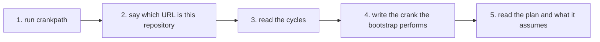

# Write your cranks

A crank is the manual step of a bootstrap that starts what nothing else can (see [concepts](concepts.md#crank)). Every estate that deploys its own Git server, secrets backend or GitOps controller has at least one, usually written down in a runbook or a bootstrap script, if at all. Writing it in `crankpath.yaml` lets crankpath show which cycles it breaks and where it goes in the restoration plan, and shows the cycles no crank breaks yet.

This page walks through the documentation example in `test/fixtures/docs-example`: an Argo CD Application `argocd/gitea` that deploys Gitea and reads its own source from that Gitea, and an Application `argocd/notes` that reads from the same Gitea. Every output below is from a real run of the commands shown, run in that folder with helm and kustomize not on PATH; the test named in [the claim map](claims.md) re-runs each command and compares.


Text fallback: run crankpath; tell it which repository URL is a copy of the scanned one; read the cycles it finds; write the crank the bootstrap already performs; then read the plan and the assumptions it rests on.

## 1. Run it and read what it could not see

<!-- claim CL-3 -->
Excerpt of `crankpath repo --repo-url https://github.com/example-org/estate --no-network`, run 2026-11-16 in `test/fixtures/docs-example`:

```text
Opacity: 2 of 2 sources opaque (100%); sources are Applications,
    ApplicationSets, Kustomizations, HelmReleases and Kustomize roots; 0 files
    unreadable.
  found: 2 Applications, 0 ApplicationSets, 0 Kustomizations, 0 HelmReleases, 0
      Kustomize roots; 3 files hold no source document
  opaque 1 of 2  node: Application "argocd/gitea"  reason: unreadable-repo
    could not see: objects under its source path
    field: "spec.source.repoURL"
        value: "http://gitea-http.gitea:3000/ops/estate"  (not this repository
        and not mapped)
    suggested repos entry (not
        applied): "http://gitea-http.gitea:3000/ops/estate": {read_from: .}
  opaque 2 of 2  node: Application "argocd/notes"  reason: unreadable-repo
    could not see: objects under its source path
    field: "spec.source.repoURL"
        value: "http://gitea-http.gitea:3000/ops/estate"  (not this repository
        and not mapped)
    suggested repos entry (not
        applied): "http://gitea-http.gitea:3000/ops/estate": {read_from: .}
```

Both Applications read `http://gitea-http.gitea:3000/ops/estate`, the in-cluster Gitea. crankpath does not know that this URL serves a copy of the scanned repository, and it never guesses that two URLs name one repository, so both sources are opaque and the run has gaps. It prints the `repos:` entry that would read them as a suggestion and does not apply it.

## 2. Say which URL is this repository

If the URL is a copy of the scanned repository (here Gitea mirrors it), say so: `--repo-alias <url>=<path>` on the command line (your input, listed as an assumption), or the suggested `repos:` entry in `crankpath.yaml` (a declared fact of the repository, which counts as a gap). Then the cycle appears:

<!-- claim CL-2 -->
Excerpt of `crankpath repo --repo-url https://github.com/example-org/estate --repo-alias http://gitea-http.gitea:3000/ops/estate=repo --no-network`, run 2026-11-16 in `test/fixtures/docs-example`:

```text
Cycles: 1 uncranked
  cycle c-0b9310f2  label: extracted  nodes: 3  edges: 4
    Application "argocd/gitea" reads source from Service "gitea/gitea-http"
        [field: "spec.source.repoURL"]
    Service "gitea/gitea-http" deployed by Application "argocd/gitea"
        [field: "spec.source.path"]
    shortest cycle shown; 2 more edges of this component are listed in the JSON
        output

Not startable from a cold start: 5 of 5 nodes (5 blocked, 0 unverified); 0
    startable
  blocked by cycle c-0b9310f2 (extracted): 5 nodes
    Application "argocd/gitea"
    Application "argocd/notes"  via Service "gitea/gitea-http"
    ConfigMap "notes/notes"  via Application "argocd/notes"
    Deployment "gitea/gitea"
    Service "gitea/gitea-http"
  unresolved items: 0
```

## 3. Read the cycles

`c-0b9310f2` is the whole strongly connected component: the Application reads its source from the Service it deploys, and the Service selects the Deployment the Application also deploys. <!-- claim CL-2 --> Nothing in it can start first, so every node of the estate is blocked, including `argocd/notes`, which only needs the Gitea Service. The label `extracted` says every edge of it was read from the estate.

Ask what breaks it in the real bootstrap. Typical answers: the first install reads from a public copy of the repository (a reroute), a manifest or chart is applied by hand (`creates`, often `creates: render:<path>`), a Secret is created by a person (`creates: Secret/...`). If the honest answer is "nothing, we would be stuck", the cycle is the finding: leave it uncranked.

## 4. Write the crank

Here the bootstrap points the gitea Application at the GitHub copy for the first sync, then switches it back. `cranked.yaml` in the example says so, and declares that GitHub is up during a black start:

```yaml
# The first install, written down: Argo CD reads the gitea Application from the GitHub copy of
# this repository until Gitea runs, then the source is switched back.
external:
  github.com:
    cold_start: available
cranks:
  - reroutes:
      node: Application/argocd/gitea
      to: github.com
    by: "first install: point Application argocd/gitea at the GitHub copy, sync, then switch it back to Gitea"
    ref: docs/bootstrap.md
```

- `by` is required: the step as a person would do it. `ref` says where it is written down.
- `reroutes` names the node and the external it reads from during the bootstrap; `creates` names what the step makes exist. The keys and their rules are in [the crankpath.yaml reference](crankpath-yaml.md#cranks).
- The external must be declared under `external:`: an external whose cold start is not declared is unspecified, and whatever needs it stays blocked.

## 5. Read the plan and what it rests on

<!-- claim CL-4 -->
Excerpt of `crankpath repo --repo-url https://github.com/example-org/estate --repo-alias http://gitea-http.gitea:3000/ops/estate=repo --config cranked.yaml --no-network`, run 2026-11-16 in `test/fixtures/docs-example`:

```text
Cycles: 0 uncranked, 1 cranked
  cycle c-0b9310f2  label: cranked (was extracted)  nodes: 3  edges: 4
    cranked by: crank 1
        by: "first install: point Application argocd/gitea at the GitHub copy, sync, then switch it back to Gitea"
        (documented, not verified)
    Application "argocd/gitea" reads source from Service "gitea/gitea-http"
        [field: "spec.source.repoURL"]
    Service "gitea/gitea-http" deployed by Application "argocd/gitea"
        [field: "spec.source.path"]
    shortest cycle shown; 2 more edges of this component are listed in the JSON
        output

Not startable from a cold start: 0 of 5 nodes; 5 startable, relative to the
    assumptions under the plan
  unresolved items: 0

External preconditions (declared cold-start availability):
  external "github.com"  available (declared, not verified)

Plan (an order, not a schedule; cold-load pickup is not modelled): 6 steps
  step 1  manual  crank 1
      by: "first install: point Application argocd/gitea at the GitHub copy, sync, then switch it back to Gitea"
      ref: "docs/bootstrap.md"
    reroutes: Application "argocd/gitea" to external "github.com"
  step 2  start   Application "argocd/gitea"
  step 3  start   Deployment "gitea/gitea"
  step 4  start   Service "gitea/gitea-http"
  step 5  start   Application "argocd/notes"
  step 6  start   ConfigMap "notes/notes"
```

The cycle is still listed, now `cranked (was extracted)`, with the crank that breaks it, `documented, not verified`. The plan starts with the crank as a `manual` step, then orders the rest. The line under the plan lists what it assumes: the external declared available, the crank, the repository read through `--repo-alias`. crankpath has checked none of these; it has only followed the edges it read.

## A directory applied by hand

Many bootstraps start by rendering a chart or a Kustomize directory and applying it by hand: the first Argo CD install, which then deploys everything else. Nothing in the estate deploys that directory, so crankpath lists it as not deployed by anything read and does not graph its objects, and if it is the only way in, the run is `NOTHING ANALYSED`. Say what the bootstrap does:

```yaml
cranks:
  - creates: render:system/argocd
    namespace: argocd
    release: argocd
    by: "render system/argocd with helm template and apply it as release argocd in namespace argocd"
    ref: docs/bootstrap.md
```

crankpath then renders `system/argocd` as the bootstrap does (the same chart, namespace and release), and the crank creates what it renders: the Argo CD install and, typically, the root Application or ApplicationSet, which is then planned and expanded like any other source. If the first install also points Argo CD at another Git server, add the `reroutes:` of the nodes it points there, as in step 4. The rules are in [the crankpath.yaml reference](crankpath-yaml.md#cranks); the README's homelab section shows this crank on a real estate.

## What a crank does not do

- It does not run, check or time the step. A crank that does not work in practice gives a plan that does not work.
- It is not a way to make a report pass: a crank that names a node of a cycle the bootstrap does not really break hides that cycle, and the report still names the crank on the cycle so a reviewer can see it.
- Its own prerequisites are not modelled: cranks apply in file order, and the plan puts each before what it makes possible.
- A target that matches no node is an unresolved item, and a crank none of whose targets matches is listed as unused.
