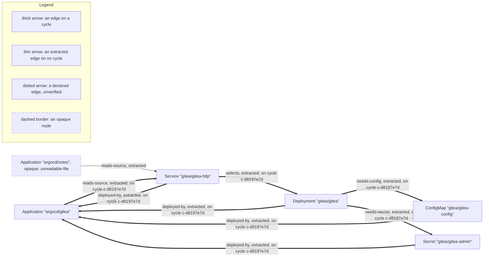

```text
crankpath 0.1.0
scanned: repo "http://gitea-http.gitea:3000/ops/thin-slice" (from --repo-url)
    commit: not read in this build  floating: no
Run status: ANALYSED WITH GAPS
  gaps: 1 source opaque; 2 objects skipped
Cycles: 1 uncranked
drawn: every node and edge of the graph as read (6 nodes, 9 edges); the run has
    gaps, listed above, so the estate may hold more
```



```text
Text fallback: the nodes and edges drawn above.
nodes: 6
  n1  Application "argocd/gitea"
  n2  Application "argocd/notes"  opaque: unreadable-file
  n3  ConfigMap "gitea/gitea-config"
  n4  Deployment "gitea/gitea"
  n5  Secret "gitea/gitea-admin"
  n6  Service "gitea/gitea-http"
edges: 9 (from -> to  kind  source)
  Application "argocd/gitea" -> Service "gitea/gitea-http"  reads-source
      extracted  cycle: c-d8197e7d
  Application "argocd/notes" -> Service "gitea/gitea-http"  reads-source
      extracted
  ConfigMap "gitea/gitea-config" -> Application "argocd/gitea"  deployed-by
      extracted  cycle: c-d8197e7d
  Deployment "gitea/gitea" -> Application "argocd/gitea"  deployed-by  extracted
      cycle: c-d8197e7d
  Deployment "gitea/gitea" -> ConfigMap "gitea/gitea-config"  needs-config
      extracted  cycle: c-d8197e7d
  Deployment "gitea/gitea" -> Secret "gitea/gitea-admin"  needs-secret
      extracted  cycle: c-d8197e7d
  Secret "gitea/gitea-admin" -> Application "argocd/gitea"  deployed-by
      extracted  cycle: c-d8197e7d
  Service "gitea/gitea-http" -> Application "argocd/gitea"  deployed-by
      extracted  cycle: c-d8197e7d
  Service "gitea/gitea-http" -> Deployment "gitea/gitea"  selects  extracted
      cycle: c-d8197e7d
```
